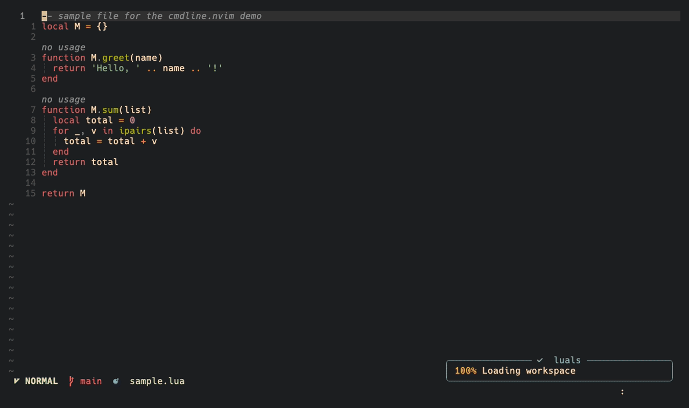

# neat.nvim

A cmdline popup, a statusline and small UI replacements for Neovim 0.12, in one
plugin. Every module is off until you turn it on, like snacks.nvim.

neat has no plugin dependencies of its own. `input`, `notify`, `indent` and
`rename` are adapted from snacks.nvim, and that code ships inside neat (see
[Credits](#credits-and-licence)): you do not need snacks.nvim installed.
`cmdline` needs nui.nvim, and a few modules use telescope, gitsigns or
nvim-web-devicons when they are there.

| Module | What it does | Replaces |
| --- | --- | --- |
| `cmdline` | Centred command-line popup on top of ui2 | noice.nvim |
| `statusline` | Small statusline that reads per-buffer caches instead of polling | lualine.nvim |
| `select` | Telescope dropdown for `vim.ui.select`, with dressing's code-action layout; falls back to the builtin without telescope | dressing.nvim |
| `spell` | `z=` lists spelling suggestions through `vim.ui.select`, so they open in your picker (neat's `select`, fzf-lua, snacks, ...) | |
| `pack` | Hints in `vim.pack`'s update flow: the review buffer says `:w` applies and `:q` cancels, and a notification after an update says `:restart` loads the new code | |
| `input` | Floating `vim.ui.input` with history and completion (neo-tree's file completion works) | snacks.nvim input |
| `notify` | `vim.notify` backends (`builtin` toasts, `native` ui2, `nvim-notify`) | snacks.nvim notifier |
| `indent` | Indent and scope guides (`builtin`, without animation, or `blink` for blink.indent) | snacks.nvim indent |
| `rename` | `require('neat.rename').on_rename_file(from, to)` sends LSP `willRenameFiles`/`didRenameFiles`; wire it to neo-tree's `FILE_MOVED`/`FILE_RENAMED` | snacks.nvim rename |



## Install

```lua
vim.pack.add({
  'https://github.com/baggiponte/neat.nvim',
  'https://github.com/MunifTanjim/nui.nvim', -- only for `cmdline`
})

require('neat').setup({
  cmdline = { enabled = true },
  statusline = { enabled = true },
  select = { enabled = true },
  input = { enabled = true },
  notify = { enabled = true },  -- backend = 'builtin' by default
  indent = { enabled = true },  -- backend = 'builtin' by default
  spell = { enabled = true },   -- z= through vim.ui.select
  pack = { enabled = true },    -- hints in vim.pack's update review
})
```

Instead of calling `setup()`, you can set `vim.g.neat` to the same table (or a
function returning it) before `vim.pack.add()`, and `plugin/neat.lua` starts it.
Set `vim.g.loaded_neat = true` to turn the plugin off entirely.

Options are checked with `vim.validate()` and misspelled keys show up in
`:checkhealth neat`. Full reference: `:h neat`.

## Startup cost

`plugin/neat.lua` only defines `:Neat`. The heavy parts load on first use: the
input window on the first `vim.ui.input()`, the builtin notifier on the first
`vim.notify()`, the builtin indent engine with the first file buffer, and the
cmdline popup after `VimEnter`. The statusline loads at setup because it draws
the first screen.

## Commands and health

| Command | What it does |
| --- | --- |
| `:Neat cmdline enable\|disable\|toggle` | Turn the cmdline popup on or off |
| `:Neat statusline enable\|disable\|toggle\|refresh` | Take `'statusline'` over or hand it back; `refresh` drops every cache and redraws |
| `:Neat indent on\|off\|toggle` | Turn the builtin indent guides on or off |
| `:Neat notifications` | Notification history of the active backend |

`:checkhealth neat` checks Neovim, unknown options, the plugins each module
needs (nui.nvim, telescope, nvim-notify, blink.indent, gitsigns,
nvim-web-devicons), whether another plugin replaced `vim.notify`,
`vim.ui.select`, `vim.ui.input` or `'statusline'` after neat, and whether each
ui2 patch applied.

## cmdline

The popup sits on top of Neovim's built-in ui2 (`vim._core.ui2`). neat turns
ui2 on if your config did not (`ui2 = { enable = false }` to skip that) and
sets `'cmdheight'` to 0 (`ui2 = { cmdheight = false }` leaves it), so no empty
row is left under the statusline. Completion stays with your completion plugin.

Messages are routed by kind, like noice does it (`lua/neat/cmdline/messages.lua`):

| Kind | Goes to |
| --- | --- |
| errors and warnings (`emsg`, `wmsg`, `lua_error`, ...) | a `vim.notify()` toast |
| `:echo`, `print()`, `:ls`, `:set` (`echo`, `lua_print`, `list_cmd`, ...) | a toast, or ui2's pager when longer than `pager_lines` (5) |
| `:!cmd` output (`shell_*`) | ui2's pager |
| anything else (`bufwrite`, `undo`, `progress`, ...) | ui2's message window |
| `confirm()`, `:s///c` | neat's confirm float |
| `z=`, `inputlist()` lists | ui2's dialog |

Toasts need neat's `notify` module with the `builtin` or `nvim-notify` backend;
otherwise those messages stay with ui2. `:messages` and `g<` still work. Change
a route with `messages = { routes = { echo = 'ui2' } }`, or set
`messages = { enabled = false }` to leave every message to ui2.

Both the popup and ui2 attach to the cmdline UI events, so without help
the command line would be drawn twice: in the popup and on ui2's bottom line.
neat wraps ui2's handlers (`lua/neat/cmdline/ui2.lua`):

- ui2 still sees `cmdline_show`, but with empty content. It keeps track of
  the cmdline level and prompt, so it hides showcmd and the ruler and routes
  messages to its dialog while you type, but its bottom line stays empty.
- `confirm()` and `:s///c` prompts open in their own float
  (`lua/neat/cmdline/confirm.lua`): `confirm = { style = 'center' }` (middle of
  the editor), `'box'` (top centre, like noice), `'toast'` (top-right corner) or
  `'ui2'` (ui2's bottom line).
- `cmdline_hide` and multi-line `cmdline_block_*` events go to ui2 as-is.
- ui2's pager (`:messages`, `g<`, long output) opens as a centred float
  with a border instead of a panel at the bottom (`lua/neat/cmdline/pager.lua`).
  ui2 still owns it: `q` closes it. Set `ui2 = { pager = false }` to keep
  the panel.

With `'cmdheight'` 0 the statusline takes over what the cmdline row showed:
`recording @q`, the search count `[3/12]` and pending keys (`showcmd`).

Set `ui2 = { disable_cmdline = false }` to leave ui2 alone (the cmdline then
shows in both places). This relies on ui2's private module layout; if it
changes, neat stops patching and the popup still works.

Defaults (see `lua/neat/cmdline/config/init.lua`):

```lua
cmdline = {
  enabled = true,
  cmdline = {
    view = 'cmdline_popup', -- or 'cmdline' for a classic bottom line
    opts = {},              -- view options for every format
    format = {
      cmdline     = { pattern = '^:', icon = '', lang = 'vim' },
      search_down = { kind = 'search', pattern = '^/', icon = ' ', lang = 'regex' },
      search_up   = { kind = 'search', pattern = '^%?', icon = ' ', lang = 'regex' },
      filter      = { pattern = '^:%s*!', icon = '$', lang = 'bash' },
      lua         = { pattern = { '^:%s*lua%s+', '^:%s*lua%s*=%s*', '^:%s*=%s*' }, icon = '', lang = 'lua' },
      help        = { pattern = '^:%s*he?l?p?%s+', icon = '' },
      calculator  = { pattern = '^=', icon = '', lang = 'vimnormal' },
      input       = { view = 'cmdline_input', icon = '󰥻 ' }, -- input()
    },
  },
  messages = {
    enabled = true,
    pager_lines = 5,
    routes = { emsg = 'notify', echo = 'auto', list_cmd = 'auto', shell_out = 'pager', ... }, -- 'notify' | 'pager' | 'auto' | 'ui2' | false
  },
  confirm = { style = 'center', title = ' Confirm ' }, -- 'center' | 'box' | 'toast' | 'ui2'
  ui2 = {
    enable = true,     -- turn ui2 on if your config did not
    cmdheight = 0,     -- or false to leave 'cmdheight' alone
    disable_cmdline = true,
    pager = { width = 0.8, height = 0.6, border = 'rounded', title = ' Messages ' }, -- or false
  },
  throttle = 1000 / 30,
  views = {},  -- override cmdline, cmdline_popup, cmdline_input
  format = {},
  debug = false,
}
```

Highlight groups keep noice's names (`NoiceCmdlinePopup`,
`NoiceCmdlinePopupBorder`, `NoiceCmdlineIcon`, ...), and the popup buffer keeps
the `noice` filetype, so colorschemes that theme noice keep working.

## statusline

Same sections, palette and components as the lualine setup it replaced, plus
LSP progress (`lsp_progress`, next to the client names in section `y`), with
`man`, `neo-tree`, `oil` and `quickfix` layouts. Each component reads a
per-buffer cache that autocmds invalidate (`DiagnosticChanged`,
`GitSignsUpdate`, `LspAttach`, `BufWritePost`, ...), and updates go through a
single scheduled `redrawstatus!`.

Defaults live in `lua/neat/statusline/config.lua`. Sections `a`, `b`, `c`, `x`,
`y`, `z` take built-in component names (`mode`, `branch`, `diff`, `fileicon`,
`filepath`, `filename`, `diagnostics`, `lsp`, `lsp_progress`, `location`,
`progress`, `recording`, `searchcount`, `showcmd`) or
functions `function(ctx) return string end`. Colours are palette keys, hex
strings or highlight tables; 256-colour fallbacks are derived for terminals
without truecolor. The `Stl*` highlight groups are defined with
`default = true`, so a colorscheme or your config can override them. The
default palette is gruvbox-material.


## select, input, notify, indent

```lua
select = { enabled = true, trim_prompt = true, telescope = nil, format_item_override = {} },
spell = { enabled = true },          -- z= through vim.ui.select (any picker; Neovim's numbered list by default)
pack = { enabled = true },           -- vim.pack.update(): winbar `:w applies, :q cancels`; `:restart` reminder after
input = { enabled = true },          -- icon, icon_pos, prompt_pos, win, expand (as in snacks' input)
notify = {
  enabled = true,
  backend = 'builtin',               -- 'builtin' | 'native' | 'nvim-notify'
  builtin = {},                      -- builtin notifier options (same keys as snacks' notifier)
  nvim_notify = {},                  -- passed to require('notify').setup()
},
indent = {
  enabled = true,
  backend = 'builtin',               -- 'builtin' | 'blink'
  builtin = {},                      -- builtin guide options (same keys as snacks' indent)
  blink = {},                        -- passed to require('blink.indent').setup()
},
```

`builtin` is neat's own copy of the snacks.nvim code, so its options keep
snacks' names, but it never loads snacks.nvim.


## Develop

Formatting runs on commit through [prek](https://github.com/j178/prek)
(`prek install` once; `prek run --all-files` to format everything), with the
StyLua version CI uses.

The `check` workflow runs stylua, a LuaLS type check (errors only), and
`tests/smoke.lua`, which loads neat.nvim headless the way `vim.pack` does and
exercises each module, `:Neat` and `:checkhealth neat`:

```sh
git clone --depth 1 https://github.com/MunifTanjim/nui.nvim deps/nui.nvim
nvim --headless --clean --cmd "set rtp^=$PWD/deps/nui.nvim" --cmd "set rtp^=$PWD" -c 'luafile tests/smoke.lua'
```

`dev/` holds the demo recordings and the review tooling used while replacing
noice, snacks, dressing and lualine.

## Credits and licence

neat.nvim is Apache-2.0. The cmdline module is a trimmed copy of
[noice.nvim](https://github.com/folke/noice.nvim) by Folke Lemaitre; `input`,
`notify`, `indent`, `rename` and the window code adapt
[snacks.nvim](https://github.com/folke/snacks.nvim); `select` adapts
[dressing.nvim](https://github.com/stevearc/dressing.nvim) by Steven
Arcangeli; the statusline adapts
[lualine.nvim](https://github.com/nvim-lualine/lualine.nvim). See `NOTICE` and
`LICENSES/`; every adapted file starts with a header naming its source and what
changed.
