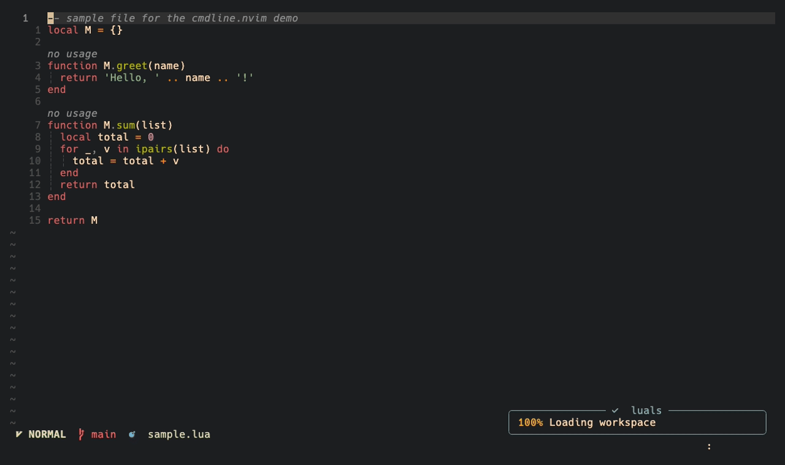

# cmdline.nvim

The centred command-line popup from [noice.nvim](https://github.com/folke/noice.nvim),
and nothing else. Messages, `:messages`, `g<` and confirm dialogs stay with
Neovim's built-in ui2 (`vim._core.ui2`); completion stays with your completion
plugin (blink.cmp, nvim-cmp, or the native wildmenu).

It is a trimmed copy of noice.nvim: the cmdline UI, its views and the text
rendering are kept as they were, and noice's message router, filters, message
history, popupmenu, notify/LSP integrations, commands and health checks are gone.


## Requirements

- Neovim 0.12+
- [nui.nvim](https://github.com/MunifTanjim/nui.nvim)

## Setup

cmdline.nvim lives in [neat.nvim](https://github.com/baggiponte/neat.nvim) and is
published on its own `cmdline` branch. With `vim.pack`:

```lua
vim.pack.add({
  'https://github.com/MunifTanjim/nui.nvim',
  { src = 'https://github.com/baggiponte/neat.nvim', version = 'cmdline', name = 'cmdline.nvim' },
})
require('cmdline').setup({})
```

cmdline.nvim takes over the cmdline UI, so it stays off until you call
`setup()`. Instead of calling it, you can set `vim.g.cmdline` (a table of
options, or a function returning one) before `vim.pack.add()`, and the plugin
starts itself. Either way the popup loads after `VimEnter`, so it costs nothing
at startup. Set `vim.g.loaded_cmdline = true` to turn the plugin off entirely.

Enable ui2 as usual, early in your config:

```lua
require('vim._core.ui2').enable({})
```

## How it coexists with ui2

Both cmdline.nvim and ui2 attach to the cmdline UI events, so without help
the command line would be drawn twice: in the popup and on ui2's bottom line.
cmdline.nvim wraps ui2's cmdline handlers (`lua/cmdline/ui2.lua`):

- ui2 still sees `cmdline_show`, but with empty content. It keeps track of
  the cmdline level and prompt, so it hides showcmd and the ruler and routes
  messages to its dialog while you type, but its bottom line stays empty.
- `confirm()` and `:s///c` prompts open in their own float
  (`lua/cmdline/confirm.lua`): `confirm = { style = 'box' }` (top centre, like
  noice), `'toast'` (top-right corner) or `'ui2'` (ui2's bottom line).
- `cmdline_hide` and multi-line `cmdline_block_*` events go to ui2 as-is.
- ui2's pager (`:messages`, `g<`, long output) opens as a centred float
  with a border instead of a panel at the bottom (`lua/cmdline/pager.lua`).
  ui2 still owns it: `q` closes it. Set `ui2 = { pager = false }` to keep
  the panel.

Set `ui2 = { disable_cmdline = false }` to leave ui2 alone (the cmdline then
shows in both places). This relies on ui2's private module layout; if it
changes, cmdline.nvim stops patching and the popup still works.

## Options

Defaults, see `lua/cmdline/config/init.lua`:

```lua
{
  cmdline = {
    view = 'cmdline_popup', -- or 'cmdline' for a classic bottom line
    opts = {},              -- view options for every format
    format = {
      cmdline     = { pattern = '^:', icon = '', lang = 'vim' },
      search_down = { kind = 'search', pattern = '^/', icon = ' ', lang = 'regex' },
      search_up   = { kind = 'search', pattern = '^%?', icon = ' ', lang = 'regex' },
      filter      = { pattern = '^:%s*!', icon = '$', lang = 'bash' },
      lua         = { pattern = { '^:%s*lua%s+', '^:%s*lua%s*=%s*', '^:%s*=%s*' }, icon = '', lang = 'lua' },
      help        = { pattern = '^:%s*he?l?p?%s+', icon = '' },
      calculator  = { pattern = '^=', icon = '', lang = 'vimnormal' },
      input       = { view = 'cmdline_input', icon = '󰥻 ' }, -- input()
    },
  },
  confirm = { style = 'box', title = ' Confirm ' }, -- 'box' | 'toast' | 'ui2'
  ui2 = {
    disable_cmdline = true,
    pager = { width = 0.8, height = 0.6, border = 'rounded', title = ' Messages ' }, -- or false
  },
  throttle = 1000 / 30,
  views = {},  -- override cmdline, cmdline_popup, cmdline_input
  format = {},
  debug = false,
}
```

Options are checked with `vim.validate()` when the popup starts; misspelled
keys show up in `:checkhealth cmdline`.

## Commands and health

`:Cmdline enable`, `:Cmdline disable` and `:Cmdline toggle` turn the popup on
and off (also `require('cmdline').enable()`, `.disable()`, `.toggle()`).

`:checkhealth cmdline` checks Neovim and nui.nvim, reports unknown options, and
says whether each ui2 patch (cmdline handlers, pager float, confirm dialog)
applied. If ui2's private modules change shape, this is where it shows.

## Highlights

Highlight groups keep noice's names (`NoiceCmdlinePopup`,
`NoiceCmdlinePopupBorder`, `NoiceCmdlineIcon`, `NoiceCmdlinePopupBorder<Kind>`,
...), and the popup buffer keeps the `noice` filetype, so colorschemes and
plugins that already handle noice's popup keep working.

## Demo

The GIF at the top shows the cmdline popup (`:` commands, completion, `:lua`,
search, filter, input). This one shows `:messages` in ui2's pager as a centred
float, and `confirm()` and `:s///c` in a box:



For comparison, the same steps with noice.nvim are in `demo/out/baseline/`.

`demo/cmdline.tape` runs the same steps against two configs:

```sh
demo/record.sh baseline   # NVIM_APPNAME=nvim (noice.nvim)
demo/record.sh cmdline    # NVIM_APPNAME=nvim-cmdline (this plugin)
demo/record.sh cmdline-toast dialogs   # dialogs.tape: :messages, confirm(), :s///c
```

Recordings (GIF, MP4 and one PNG per step) are in `demo/out/<name>/`.

## Licence

Apache-2.0, like noice.nvim. See `LICENSE`, `NOTICE` and `LICENSES/`.
